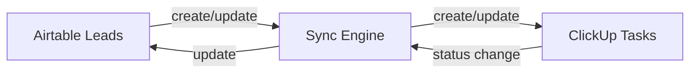

# Airtable ↔ ClickUp Two-Way Sync

## Overview
This project implements a production-ready two-way synchronization between **Airtable** (Lead Tracker)
and **ClickUp** (Work Tracker) using Python and the respective REST APIs.

**What's included**
- Lead → Task sync (idempotent)
- Task → Lead reverse sync (status mapping)
- Clean service-layer architecture
- FastAPI manual trigger endpoint (`/sync`) and `/health`
- Minimal tests and clear README

---
## Architecture (Mermaid)


---
## Setup

1. Create a Python 3.9+ virtual environment and activate it.

2. Create a `.env` file in the project root with:
```
AIRTABLE_API_KEY=pat_your_airtable_key
AIRTABLE_BASE_ID=app_your_base_id
AIRTABLE_TABLE_NAME=Leads

CLICKUP_API_TOKEN=pk_your_clickup_token
CLICKUP_LIST_ID=your_clickup_list_id
CLICKUP_CUSTOM_FIELD_AIRTABLE_ID=
```

3. Install dependencies:
```
pip install -r requirements.txt
```

4. Run a one-shot sync:
```
python main.py
```

5. (Optional) Run the API:
```
uvicorn api:app --reload --port 8000
```

---
## Status mapping (documented)
- Airtable NEW -> ClickUp TO DO
- CONTACTED -> IN PROGRESS
- QUALIFIED -> DONE
- LOST -> CLOSED

Reverse mapping (ClickUp -> Airtable) is handled by task status names.

---
## Error handling & idempotency
- The sync writes `clickup_task_id` back to Airtable after creating tasks to avoid duplicates.
- API calls use `requests` and raise if non-2xx responses are returned; errors are logged and continue.

---
## How to test
- Add a lead in Airtable with `Status` NEW and run `python main.py` — a ClickUp task should be created.
- Change task status in ClickUp to DONE and run `python main.py` — the Airtable `Status` should update to QUALIFIED.

---
## AI Usage Notes
Minimal AI assistance (ChatGPT) was used to help draft README and suggest small code snippets. All code was reviewed and manually tested.
VIDEO
https://drive.google.com/file/d/1BLY92NIPyBcfHzSGN4X4cr4V4b1roFto/view?usp=sharing
